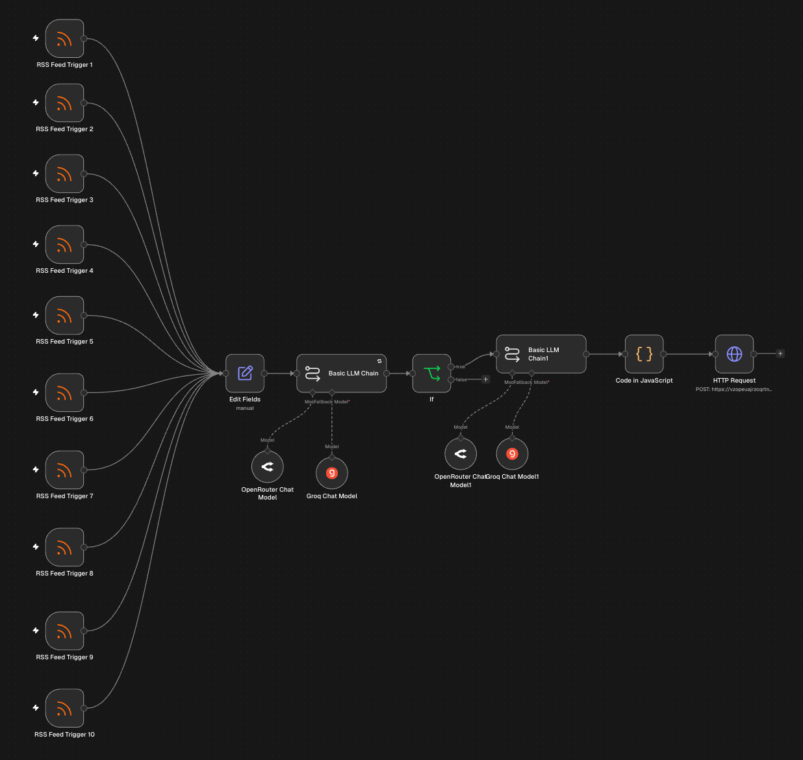
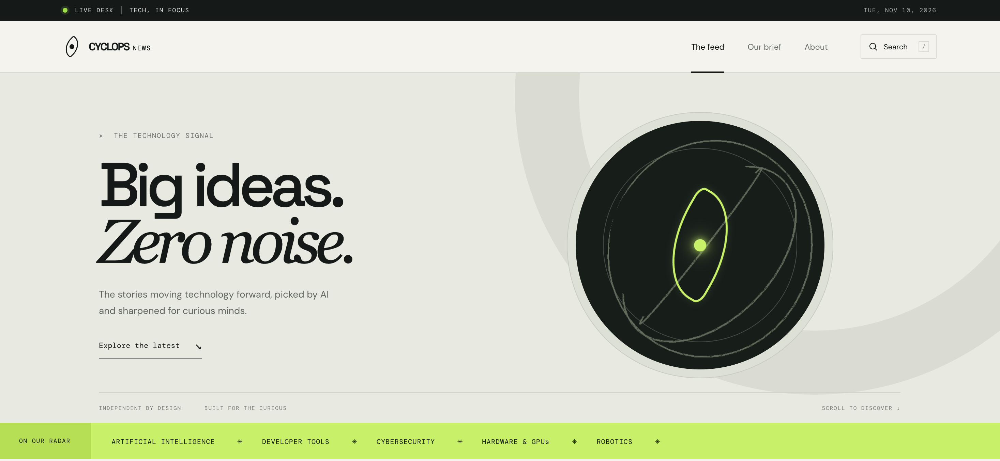
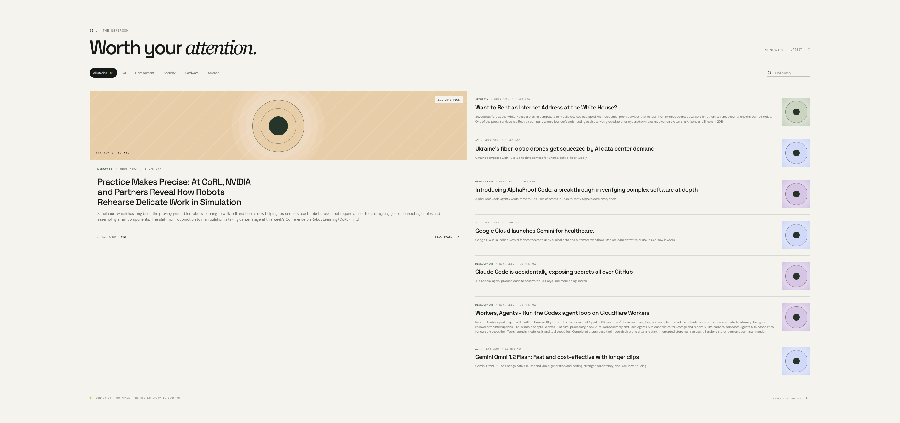
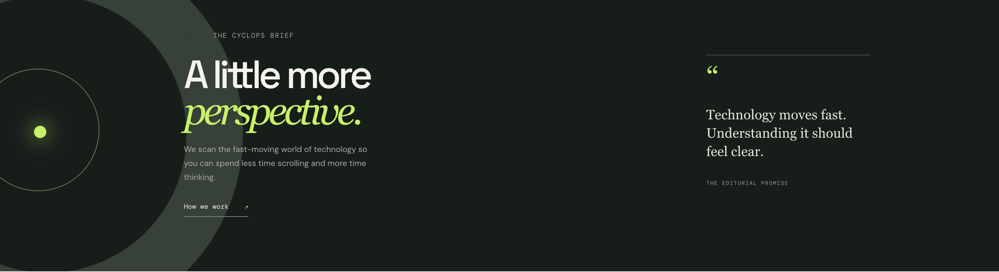
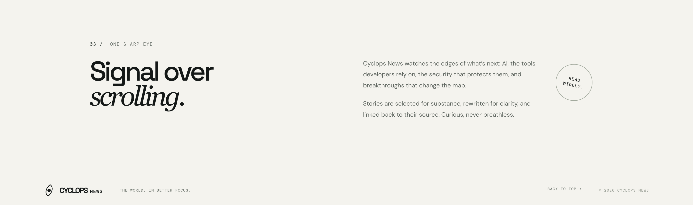
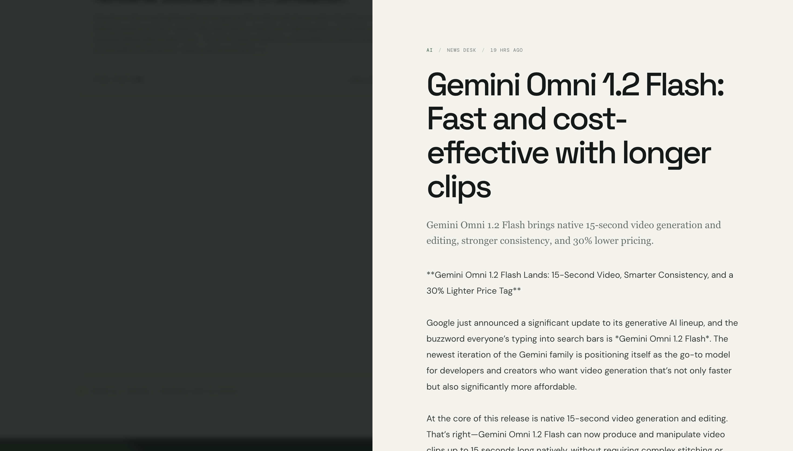

# Cyclops News

Cyclops News is an AI-assisted technology news desk built with **n8n**. It gathers stories from RSS feeds, scores them for relevance, turns selected items into readable article drafts, and publishes them to a live news site with links to the original sources.

The project combines a lightweight, responsive frontend with an n8n automation workflow and Supabase-backed publishing. Readers can browse AI, development, security, hardware, science, and robotics coverage, filter and search the feed, and open individual stories.

## Live website

[Visit Cyclops News](https://cyclops-ai-news.onrender.com)

## How the n8n workflow works

The workflow shown above fans multiple RSS Feed Triggers (10 in the current workflow) into a shared processing path:

1. **Collect** — RSS triggers watch technology news sources and pass new items into the workflow.
2. **Prepare fields** — Edit Fields standardizes the feed data used by later nodes.
3. **Score the story** — a Basic LLM Chain asks an AI model to assess the story. The workflow checks the score with an If node and continues for scores above 4 (5–10).
4. **Write a draft** — a second Basic LLM Chain creates an article draft from a selected story. Groq and OpenRouter Chat Model nodes are attached as model options in the workflow.
5. **Format and publish** — the JavaScript Code node combines the RSS metadata, score, and generated draft into the site's article fields. The HTTP Request node sends the result to the publishing destination.
6. **Store and display** — the production site reads published stories from Supabase. The frontend refreshes the feed every 15 seconds, sorts by publication time, and links each story back to its source.

The workflow is designed to reduce repetitive feed scanning while keeping source attribution visible. AI-generated copy should be reviewed before being treated as authoritative reporting. For credentials, exact prompts, destination configuration, and self-hosted publishing options, see the [setup and configuration guide](setup.md).

## Site screenshots

Screenshots are split by page or feature so each part of the site is visible on its own.

### Home

### The feed

### Our brief

### About

### Story example

## Project links

- [Source code on GitHub](https://github.com/CrAnish07/cyclops-ai-newz)
- [Setup and configuration guide](setup.md)
